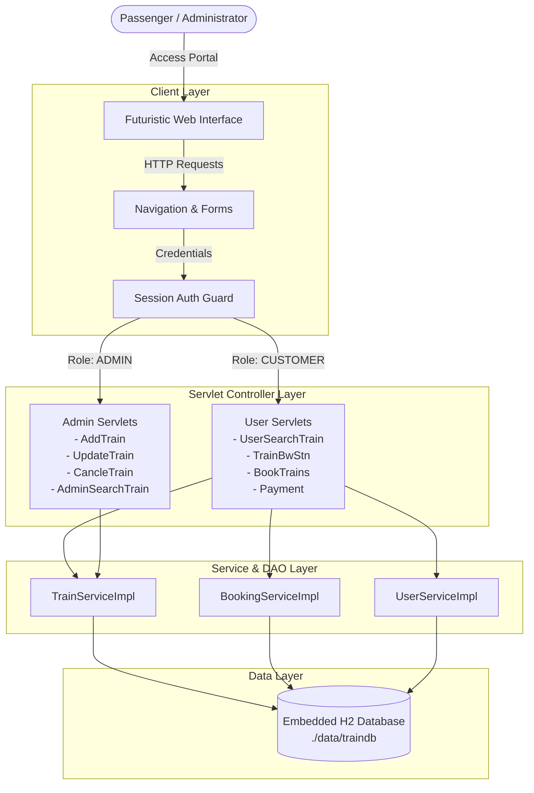
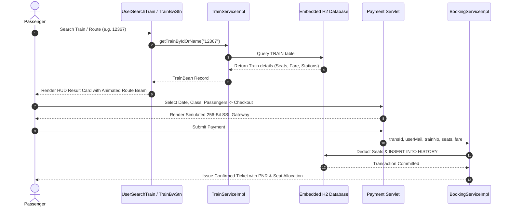

# NTBS — Cyber-Transit Train Ticket Reservation System

[](https://openjdk.org/)
[](https://maven.apache.org/)
[](https://tomcat.apache.org/)
[](https://www.h2database.com/)
[](https://github.com/Infernapx/Train-Ticket-Reservation-System)
[](LICENSE)

An enterprise-grade, high-performance Railway Reservation System built with **Java Servlets & J2EE**, featuring an embedded zero-configuration **H2 Database** and an extraordinary **Futuristic Cyber-Transit HUD** interface.

---

## 🌟 Overview & Project Scope

The **National Ticket Booking Spot (NTBS)** reimagines digital train reservation. Designed to replace outdated, cumbersome booking systems, NTBS delivers a lightning-fast, intuitive travel management experience for passengers and railway dispatchers.

### Core Problems Solved
- **Zero-Setup Database Barrier**: Traditional enterprise Java railway apps rely on complex external Oracle database setups. NTBS ships with a lightweight, embedded **H2 Database** engine that automatically bootstraps schemas and seeds realistic express train schedules on the first launch.
- **Next-Gen Visual Telemetry**: Replaces flat 2000s-style tables with a glassmorphic **Cyber-Transit UI** featuring animated route track light beams, neon indicators, and high-contrast telemetry panels.
- **Intelligent Schedule Discovery**: Handles fuzzy train lookups, trimmed whitespace, `#` prefix removal (e.g. `#12367`), and train name queries with instant feedback.
- **Role-Gated Security**: Strict session authorization cleanly separates regular passenger capabilities from railway administrative oversight.

---

## 🚀 Key Features

### 👤 Passenger Portal
- **Live Running Trains Manifest**: Real-time view of all scheduled trains, routes, current seating availability, and base fares.
- **Fuzzy Train Search**: Search by 5-digit train number (e.g., `12367`, `10001`) or name (e.g., `Vikramshila`, `Rajdhani`) with one-click quick-search chips.
- **Station-to-Station Routing**: Query direct routes between any origin and destination junction.
- **Live Seat Availability & Fare Enquiry**: Instant capacity inspection before booking.
- **Multi-Class Reservation Engine**: Support for Sleeper (`SL`), Second Sitting (`2S`), AC 3 Tier (`3A`), AC 2 Tier (`2A`), and AC First Class (`1A`).
- **Simulated 256-Bit SSL Payment Sandbox**: Card checkout simulation with instantaneous booking confirmation and unique PNR/Transaction generation.
- **Booking History**: Chronological log of all previous journeys, ticket statuses, and amounts paid.
- **Profile Management**: Account management and password update tools.

### 🛡️ Admin Command Center
- **Fleet Schedule Inspector**: Audit the status of all active routes and trains across the railway network.
- **Add New Routes**: Register new train numbers, originating stations, terminus stations, ticket fares, and maximum seat capacities.
- **Update Schedules & Capacities**: Dynamically adjust ticket pricing and seat allocation.
- **Decommission / Cancel Trains**: Safely remove outdated or cancelled trains from the active schedule.

### 🎨 Futuristic Cyber-Transit UI
- **Cosmic Obsidian Theme**: Deep dark backdrop (`#060913`) accented with multi-layer radial cyan (`#00f0ff`) and violet (`#8b5cf6`) glow meshes.
- **Glassmorphism HUD**: Translucent frosted panels (`backdrop-filter: blur(24px) saturate(180%)`) with hairline neon cyan borders.
- **Animated Transit Light Beam**: Pulsing animated electric particle beam (`@keyframes transitBeamFlow`) traveling from origin to destination.
- **Hologram Action Elements**: Radiant gradient buttons with micro-interactions and reflection sweep animations.
- **Platform Encoding Compliance**: Fully sanitized for Windows/Linux UTF-8 compatibility, preventing mojibake (`??`) artifacts.

---

## 🛠️ Technology Stack

| Layer | Technologies |
| :--- | :--- |
| **Frontend** | HTML5, Vanilla CSS3 (Custom Design System, Tokens, Keyframe Animations), Google Fonts (*Outfit*, *Space Grotesk*, *Plus Jakarta Sans*, *JetBrains Mono*) |
| **Backend** | Java 17 / J2EE, Java Servlets (`javax.servlet`), MVC Pattern |
| **Database** | Embedded H2 Database (In-Memory/Persistent file mode, Auto-Bootstrapped via `DBUtil`) |
| **Server & Packaging** | Apache Maven 3.9+, Embedded Apache Tomcat 9 (`webapp-runner`) |
| **Security** | HTTP Session Management, Role-Based Access Control (`CUSTOMER` & `ADMIN`) |

---

## 🔄 System Architecture & Flow



### Booking Lifecycle Flow



---

## 🗄️ Database Schema & Seed Data

The database initializes automatically when the application starts (`DBUtil.java`).

### 1. `TRAIN`
| Column | Type | Description |
| :--- | :--- | :--- |
| `TR_NO` | `BIGINT PRIMARY KEY` | Unique Train Number (e.g. `12367`, `10001`) |
| `TR_NAME` | `VARCHAR(70)` | Train Name (e.g. `VIKRAMSHILA EXP`, `RAJDHANI EXP`) |
| `FROM_STN` | `VARCHAR(20)` | Origin Station (e.g. `PATNA`, `HOWRAH`) |
| `TO_STN` | `VARCHAR(20)` | Terminus Station (e.g. `ANAND VIHAR`, `DELHI`) |
| `SEATS` | `INT` | Total Available Seats |
| `FARE` | `DECIMAL(6,2)` | Base Ticket Price (₹ INR) |

### 2. `CUSTOMER`
| Column | Type | Description |
| :--- | :--- | :--- |
| `MAILID` | `VARCHAR(40) PRIMARY KEY` | User Email / Login ID |
| `PWORD` | `VARCHAR(20)` | Account Password |
| `FNAME` | `VARCHAR(20)` | First Name |
| `LNAME` | `VARCHAR(20)` | Last Name |
| `ADDR` | `VARCHAR(100)` | Address |
| `PHNO` | `BIGINT` | Contact Number |

### 3. `ADMIN`
| Column | Type | Description |
| :--- | :--- | :--- |
| `MAILID` | `VARCHAR(40) PRIMARY KEY` | Administrator Email ID |
| `PWORD` | `VARCHAR(20)` | Administrator Password |
| `FNAME` | `VARCHAR(20)` | First Name |
| `LNAME` | `VARCHAR(20)` | Last Name |
| `ADDR` | `VARCHAR(100)` | Address |
| `PHNO` | `BIGINT` | Contact Number |

### 4. `HISTORY`
| Column | Type | Description |
| :--- | :--- | :--- |
| `TRANSID` | `VARCHAR(36) PRIMARY KEY` | PNR / Unique Transaction Identifier |
| `MAILID` | `VARCHAR(40)` | Booking Customer ID (Foreign Key) |
| `TR_NO` | `BIGINT` | Reserved Train Number |
| `DATE` | `DATE` | Date of Journey |
| `FROM_STN` | `VARCHAR(20)` | Boarding Station |
| `TO_STN` | `VARCHAR(20)` | Deboarding Station |
| `SEATS` | `INT` | Number of Reserved Seats |
| `AMOUNT` | `DECIMAL(8,2)` | Total Fare Paid (₹ INR) |

---

## ⚡ Quick Start Guide

### Prerequisites
- **Java Development Kit**: JDK 11 or JDK 17+
- **Build Tool**: Apache Maven 3.8+ (included or installed)

### 1. One-Click Launch (Windows)
Double-click [`start.bat`](start.bat) or execute via PowerShell:

```powershell
.\start.ps1
```

The script automatically:
1. Configures environment variables.
2. Compiles and packages the WAR file using Maven if not already built.
3. Launches the embedded Tomcat runner on port `8080`.

### 2. Manual Terminal Build & Run

```bash
# 1. Clone the repository
git clone https://github.com/Infernapx/Train-Ticket-Reservation-System.git
cd Train-Ticket-Reservation-System

# 2. Compile and package the WAR
mvn clean package -DskipTests

# 3. Launch with embedded Tomcat runner
java -jar target/dependency/webapp-runner.jar --port 8080 target/TrainBook-1.0.0-SNAPSHOT.war
```

### 3. Accessing the Application
Open your browser and navigate to:
👉 **[http://localhost:8080/index.html](http://localhost:8080/index.html)**

---

## 🔑 Pre-Configured Demo Credentials

The embedded database is pre-seeded with test accounts for instant evaluation:

| Role | Email / Username | Password | Access Level |
| :--- | :--- | :--- | :--- |
| **Passenger** | `shashi@demo.com` | `shashi` | Search, Book, View History, Profile |
| **Administrator** | `admin@demo.com` | `admin` | Add Train, Update Schedule, Cancel Train |

### 🚆 Pre-Seeded Trains for Quick Testing
- **12367** — `VIKRAMSHILA EXP` (PATNA ➔ ANAND VIHAR) — ₹ 620.00
- **10001** — `JODHPUR EXP` (HOWRAH ➔ JODHPUR) — ₹ 490.50
- **10002** — `YAMUNA EXP` (GAYA ➔ DELHI) — ₹ 550.50
- **10103** — `MAHABODHI EXP` (GAYA ➔ DELHI) — ₹ 840.00
- **12301** — `RAJDHANI EXP` (HOWRAH ➔ NEW DELHI) — ₹ 1,850.00
- **10010** — `VANDE BHARAT EXP` (NEW DELHI ➔ VARANASI) — ₹ 1,750.00

---

## 📡 API & Servlet Endpoint Reference

| Endpoint | HTTP Method | Access Role | Description |
| :--- | :---: | :---: | :--- |
| `/index.html` | `GET` | Public | Welcome portal & unified sign-in screen |
| `/userlogin` | `POST` | Public | Authenticates passenger and initializes customer session |
| `/adminlogin` | `POST` | Public | Authenticates administrator and initializes admin session |
| `/userviewtrainfwd` | `GET` | Customer | Renders live manifest of all running trains |
| `/searchtrainservlet` | `POST` | Customer | AJAX/Form train lookup by number or name with HUD card response |
| `/trainbwstn` | `POST` | Customer | Queries direct trains connecting two specified stations |
| `/useravail` | `POST` | Customer | Checks real-time seat availability for a given train number |
| `/booktrainbyref` | `GET` | Customer | Initiates direct booking flow from train manifest links |
| `/payment` | `POST` | Customer | Processes simulated payment and generates PNR ticket |
| `/bookingdetails` | `GET` | Customer | Retrieves complete booking history for logged-in user |
| `/addtrainfwd` | `GET` / `POST` | Admin | Displays form and handles registration of a new train |
| `/updatetrain` | `GET` / `POST` | Admin | Updates existing train fare, stations, or seat quotas |
| `/cancletrainfwd` | `GET` / `POST` | Admin | Cancels and deletes a train from the operational schedule |
| `/userlogout` / `/adminlogout` | `GET` | Authenticated | Terminates session and redirects to sign-in portal |

---

## 📂 Project Directory Structure

```text
Train-Ticket-Reservation-System/
├── src/
│   ├── application.properties               # Database connection string (H2)
│   └── com/shashi/
│       ├── beans/                           # Java Data Transfer Objects (TrainBean, HistoryBean, UserBean)
│       ├── constant/                        # Roles & Enums (UserRole: CUSTOMER, ADMIN)
│       ├── service/                         # Service Interfaces & Implementations
│       │   └── impl/                        # (TrainServiceImpl, BookingServiceImpl, UserServiceImpl)
│       ├── servlets/                        # HTTP Controllers & Endpoints
│       │   ├── AdminCancleTrain.java
│       │   ├── AdminSearchTrain.java
│       │   ├── BookTrains.java
│       │   ├── TrainBwStn.java
│       │   ├── UserLogin.java
│       │   ├── UserSearchTrain.java
│       │   └── UserViewTrainFwd.java
│       └── utility/                         # Database bootstrap (DBUtil) & Helpers (TrainUtil)
├── WebContent/
│   ├── UserHome_Css.css                     # Futuristic Cyber-Transit Design System
│   ├── index.html                           # Landing page & unified login portal
│   ├── SearchTrains.html                    # Train search with real-time HUD & quick-try chips
│   ├── TrainBwStn.html                      # Route discovery between stations
│   ├── BookTrains.html                      # Ticket reservation form
│   ├── Payment.html                         # Simulated 256-bit SSL checkout sandbox
│   ├── AdminHome.html                       # System administrator control center
│   ├── UserHome.html                        # Passenger navigation dashboard
│   └── WEB-INF/web.xml                      # Servlet mappings & webapp deployment descriptor
├── pom.xml                                  # Maven dependencies & build configuration
├── start.bat                                # Windows 1-click execution script
├── start.ps1                                # PowerShell launch script
└── README.md                                # Comprehensive documentation
```

---

## 🔮 Future Roadmap

- [ ] **Dynamic Seat Matrix Map**: Visual interactive coach layout selector (Window / Aisle / Upper / Lower berths).
- [ ] **Live GPS Train Tracking Simulation**: Real-time position telemetry between stations with arrival estimations.
- [ ] **Instant PDF Ticket Generation**: Downloadable boarding passes with generated QR codes for ticket validation.
- [ ] **REST API Layer**: Decouple servlets with modern JSON REST controllers for native mobile client integration.

---

## 📜 License

This project is licensed under the [MIT License](LICENSE). Feel free to use, modify, and distribute it for personal, educational, or commercial projects.
