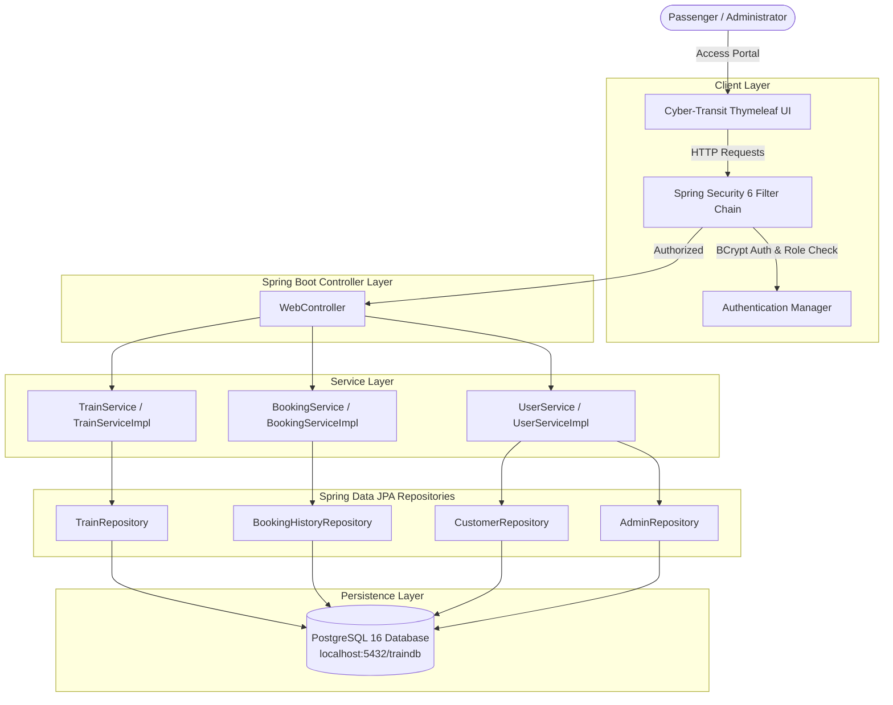
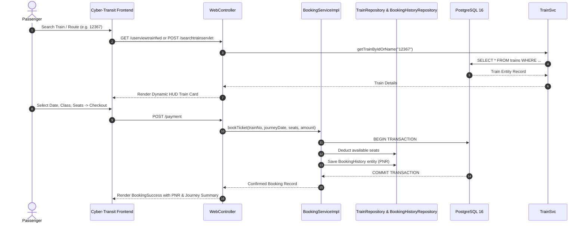

# NTBS — Modern Cyber-Transit Train Ticket Reservation System

[](https://openjdk.org/)
[](https://spring.io/projects/spring-boot)
[](https://spring.io/projects/spring-security)
[](https://spring.io/projects/spring-data-jpa)
[](https://www.postgresql.org/)
[](https://maven.apache.org/)
[](https://github.com/Infernapx/TrainTkt)
[](LICENSE)

An enterprise-grade, modern cloud-native Railway Reservation System re-architected with **Java 25 LTS**, **Spring Boot 3.3**, **Spring Security 6**, **Spring Data JPA (Hibernate 6)**, **PostgreSQL 16**, and an extraordinary **Futuristic Cyber-Transit HUD** interface powered by **Thymeleaf, HTML5, CSS3, and JavaScript**.

---

## 🌟 Modernization Overview & Architecture Evolution

The legacy application was originally built on outdated Java EE servlets, manual raw JDBC queries, and flat web pages. This version modernizes the entire stack to state-of-the-art enterprise Java standards:

| Component | Legacy Architecture | Modernized Architecture |
| :--- | :--- | :--- |
| **Java Platform** | Java 7/8 / J2EE | **Java 25 LTS** |
| **Framework** | Raw Servlets (`javax.servlet`) | **Spring Boot 3.3.4** |
| **Security & Auth** | Raw HttpSession checks | **Spring Security 6** (Form Login, BCrypt Hashing, Role Gates) |
| **Persistence Layer**| Raw JDBC `PreparedStatement` | **Spring Data JPA / Hibernate 6** with transactional repositories |
| **Database** | Oracle JDBC / Embedded H2 | **PostgreSQL 16** with automatic schema synchronization |
| **Template Engine** | Static HTML / Scriptlets | **Thymeleaf 3 + Spring Security 6 dialect** |
| **Containerization** | None | **Docker Compose** ready (`docker-compose.yml`) |
| **User Interface** | 2000s legacy table design | **Futuristic Cyber-Transit HUD** (dark mode, glassmorphism, animated route beams) |

---

## 🚀 Key Features

### 👤 Passenger Portal
- **Live Running Express Trains**: Real-time inspection of scheduled trains, routes, live seating availability, and base fares.
- **Fuzzy Train Search Engine**: Search by train number (e.g., `12367`, `10001`), partial string, or train name (`Vikramshila`, `Rajdhani`) with one-click quick-search chips.
- **Station-to-Station Routing**: Discover direct and connecting routes between any departure and arrival stations.
- **Real-Time Seat Availability & Fare Enquiry**: Dynamic calculation based on selected travel class.
- **Multi-Class Reservation Engine**: Sleeper (`SL`), Second Sitting (`2S`), AC 3 Tier (`3A`), AC 2 Tier (`2A`), and AC First Class (`1A`).
- **Simulated 256-Bit SSL Payment Gateway**: Instant ticket confirmation, seat allocation, and unique cryptographic PNR generation.
- **Booking History**: Real-time tracking of passenger journey history and e-tickets.
- **Profile Management**: Profile updates and secure password management.

### 🛡️ Admin Command Center
- **Fleet Schedule Management**: Complete view and real-time monitoring of all train routes.
- **Add New Trains & Routes**: Register new train numbers, originating stations, terminus stations, fares, and seat quotas.
- **Update Schedules & Capacities**: Dynamically adjust ticket pricing and seat allocation.
- **Decommission / Cancel Trains**: Safely decommission trains with automatic data integrity handling.

### 🎨 Futuristic Cyber-Transit UI
- **Cosmic Obsidian Theme**: High-contrast dark backdrop (`#060913`) with multi-layered neon cyan (`#00f0ff`) and violet (`#8b5cf6`) glow meshes.
- **Glassmorphism HUD**: Translucent frosted panels (`backdrop-filter: blur(24px) saturate(180%)`) with hairline neon borders.
- **Animated Transit Light Beam**: Electric particle beam (`@keyframes transitBeamFlow`) animating transit paths from origin to destination.
- **Responsive & Accessible**: Optimized for desktop, tablet, and mobile browsers with zero external UI framework dependencies.

---

## 🔄 System Architecture & Flow



### End-to-End Booking Sequence



---

## 🗄️ PostgreSQL Database Schema

Entity persistence is automatically managed by Spring Data JPA with PostgreSQL:

### 1. `trains`
| Column | Type | Description |
| :--- | :--- | :--- |
| `train_no` | `BIGINT PRIMARY KEY` | Unique 5-digit Train Number |
| `train_name`| `VARCHAR(70)` | Express / Mail / Vande Bharat Train Name |
| `from_station` | `VARCHAR(30)` | Originating Station |
| `to_station` | `VARCHAR(30)` | Terminating Station |
| `seats` | `INTEGER` | Current Available Capacity |
| `fare` | `NUMERIC(8,2)` | Base Fare (₹ INR) |

### 2. `customers`
| Column | Type | Description |
| :--- | :--- | :--- |
| `email` | `VARCHAR(80) PRIMARY KEY` | Passenger Email & Login ID |
| `password` | `VARCHAR(100)` | BCrypt Encrypted Password |
| `first_name` | `VARCHAR(50)` | Passenger First Name |
| `last_name` | `VARCHAR(50)` | Passenger Last Name |
| `address` | `VARCHAR(200)` | Residential Address |
| `phone_no` | `BIGINT` | Mobile Phone Number |

### 3. `admins`
| Column | Type | Description |
| :--- | :--- | :--- |
| `email` | `VARCHAR(80) PRIMARY KEY` | Administrator Email & Login ID |
| `password` | `VARCHAR(100)` | BCrypt Encrypted Password |
| `first_name` | `VARCHAR(50)` | Administrator First Name |
| `last_name` | `VARCHAR(50)` | Administrator Last Name |
| `address` | `VARCHAR(200)` | Department / Office Address |
| `phone_no` | `BIGINT` | Official Contact Number |

### 4. `booking_history`
| Column | Type | Description |
| :--- | :--- | :--- |
| `transaction_id` | `VARCHAR(64) PRIMARY KEY` | Unique Cryptographic PNR / Transaction ID |
| `customer_email` | `VARCHAR(80)` | Booking Customer ID (Foreign Reference) |
| `train_no` | `BIGINT` | Booked Train Number |
| `journey_date` | `DATE` | Date of Scheduled Journey |
| `from_station` | `VARCHAR(30)` | Boarding Station |
| `to_station` | `VARCHAR(30)` | Destination Station |
| `seats_booked` | `INTEGER` | Reserved Seat Count |
| `total_amount` | `NUMERIC(10,2)` | Total Fare Collected (₹ INR) |

---

## ⚡ Quick Start & Deployment

### Prerequisites
- **Java 21 or Java 25 LTS**
- **Maven 3.9+**
- **PostgreSQL 16+** (Local or via Docker)

### Option A: Launch with Docker Compose (Recommended)

1. **Start PostgreSQL in Docker**:
   ```bash
   docker compose up -d
   ```

2. **Run Spring Boot Application**:
   ```bash
   mvn spring-boot:run
   ```

### Option B: One-Click Launch on Windows

Execute the pre-configured launcher:
```powershell
.\start.ps1
```
Or double-click `start.bat`.

### Option C: Build Executable JAR

```bash
# Compile and build executable fat JAR
mvn clean package -DskipTests

# Run the packaged Spring Boot JAR with Java 25
java -jar target/traintkt-2.0.0-SNAPSHOT.jar
```

Access the application in your browser:
👉 **[http://localhost:8080/](http://localhost:8080/)**

---

## 🔑 Pre-Configured Demo Credentials

The database automatically seeds on first launch:

| Role | Username / Email | Password | Access Rights |
| :--- | :--- | :--- | :--- |
| **Passenger** | `shashi@demo.com` | `shashi` | Train Search, Booking, PNR Receipts, Booking History |
| **Administrator** | `admin@demo.com` | `admin` | Fleet Schedules, Add Train, Update Capacities, Cancellation |

### 🚆 Sample Pre-Seeded Trains
- **12367** — `VIKRAMSHILA EXP` (PATNA ➔ ANAND VIHAR) — ₹ 620.00
- **10001** — `JODHPUR EXP` (HOWRAH ➔ JODHPUR) — ₹ 490.50
- **10002** — `YAMUNA EXP` (GAYA ➔ DELHI) — ₹ 550.50
- **10103** — `MAHABODHI EXP` (GAYA ➔ DELHI) — ₹ 840.00
- **12301** — `RAJDHANI EXP` (HOWRAH ➔ NEW DELHI) — ₹ 1,850.00
- **10010** — `VANDE BHARAT EXP` (NEW DELHI ➔ VARANASI) — ₹ 1,750.00

---

## 📡 Web Controller Endpoints Reference

| Endpoint | Method | Security Role | Description |
| :--- | :---: | :---: | :--- |
| `/` or `/index.html` | `GET` | Public | Cyber-Transit portal & unified authentication screen |
| `/userlogin` | `POST` | Public | Spring Security authentication entrypoint |
| `/UserRegister.html` | `GET` / `POST` | Public | Passenger registration portal |
| `/userviewtrainfwd` | `GET` | Passenger | Live express train manifest |
| `/searchtrainservlet` | `GET` / `POST` | Passenger | Real-time train lookup by number or name |
| `/trainbwstn` | `GET` / `POST` | Passenger | Station-to-station route finder |
| `/useravail` | `GET` / `POST` | Passenger | Seat availability enquiry |
| `/fare` | `GET` / `POST` | Passenger | Fare calculation engine |
| `/booktrainbyref` | `GET` | Passenger | Direct reservation shortcut from train manifest |
| `/booktrains` | `POST` | Passenger | Step 1 booking form submission |
| `/payment` | `POST` | Passenger | Transaction settlement and PNR ticket generation |
| `/bookingdetails` | `GET` | Passenger | Historical booking records |
| `/userprofile` | `GET` / `POST` | Passenger | Profile and password management |
| `/adminhome` | `GET` | Admin | Administrative dashboard |
| `/adminviewtrainfwd` | `GET` | Admin | Fleet inspection manifest |
| `/addtrainfwd` | `GET` / `POST` | Admin | Register new express route |
| `/updatetrain` | `GET` / `POST` | Admin | Update train capacity and pricing |
| `/cancletrainfwd` | `GET` / `POST` | Admin | Cancel/delete train route |
| `/userlogout` / `/logout` | `GET` / `POST` | Authenticated | Secure session termination |

---

## 📂 Project Directory Structure

```text
TrainTkt/
├── docker-compose.yml                      # PostgreSQL container definition
├── pom.xml                                 # Modern Maven config (Java 25, Spring Boot 3.3.4)
├── start.bat                               # Windows 1-click launch batch script
├── start.ps1                               # PowerShell automated boot script
├── README.md                               # Modernized project documentation
└── src/
    └── main/
        ├── java/com/shashi/
        │   ├── TrainApplication.java       # Spring Boot main application entrypoint
        │   ├── config/
        │   │   ├── SecurityConfig.java     # Spring Security 6 authorization & password encoder
        │   │   └── DataInitializer.java    # Automatic DB bootstrap and express train seed
        │   ├── controller/
        │   │   └── WebController.java      # Unified Spring MVC Controller
        │   ├── entity/                     # JPA Hibernate entities
        │   │   ├── Admin.java
        │   │   ├── BookingHistory.java
        │   │   ├── Customer.java
        │   │   └── Train.java
        │   ├── repository/                 # Spring Data JPA repositories
        │   │   ├── AdminRepository.java
        │   │   ├── BookingHistoryRepository.java
        │   │   ├── CustomerRepository.java
        │   │   └── TrainRepository.java
        │   └── service/                    # Business service layer
        │       ├── BookingService.java
        │       ├── TrainService.java
        │       ├── UserService.java
        │       └── impl/                   # Implementation with transactional semantics
        │           ├── BookingServiceImpl.java
        │           ├── TrainServiceImpl.java
        │           └── UserServiceImpl.java
        └── resources/
            ├── application.properties      # PostgreSQL datasource & Hibernate configuration
            ├── static/
            │   └── UserHome_Css.css        # Futuristic Cyber-Transit CSS3 design system
            └── templates/                  # Modern Thymeleaf HTML5 templates
                ├── AddTrains.html
                ├── AdminHome.html
                ├── AdminUpdateTrain.html
                ├── AdminViewTrains.html
                ├── Availability.html
                ├── BookTrains.html
                ├── BookingHistory.html
                ├── BookingSuccess.html
                ├── CancleTrain.html
                ├── Fare.html
                ├── index.html
                ├── Payment.html
                ├── SearchTrains.html
                ├── TrainBwStn.html
                ├── UserHome.html
                ├── UserProfile.html
                ├── UserRegister.html
                └── UserViewTrains.html
```

---

## 📜 License

This project is licensed under the [MIT License](LICENSE).
